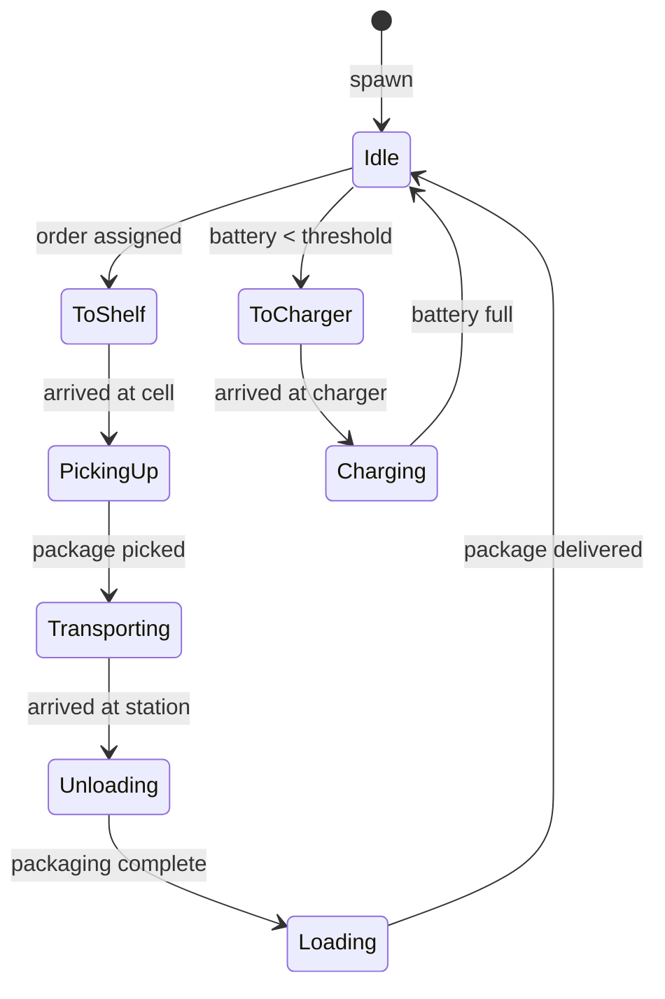
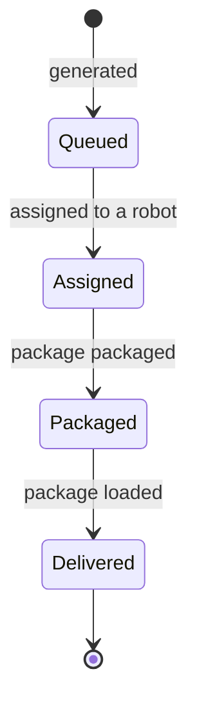
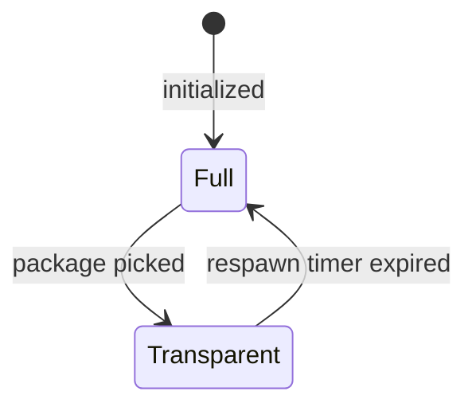
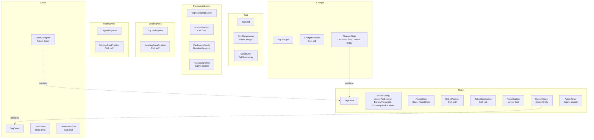
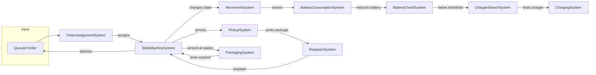
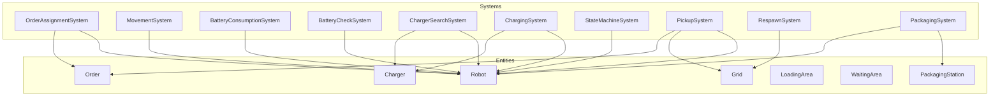

# dots-warehouse-sim — Design Document

## Overview

**dots-warehouse-sim** is a warehouse simulation built with Unity DOTS/ECS.  
A fleet of autonomous robots retrieves packages from shelf cells, carries them to a packaging station, and delivers them to a loading area. Robots also manage their own battery and recharge when needed.

The design follows a data-oriented approach: **components** hold data, **systems** operate on that data, and **entities** are formed by combining components.

---

## Vista 1 — External View (Black Box)

### Who uses the program

- **Supervisor** — sets simulation parameters (number of robots, number of orders) and monitors throughput.
- **Operator** — watches the 3D scene to check if the flow is blocked or smooth.
- *(Future)* An external system that sends orders via API.

### Input (before start)

- Number of robots to spawn.
- Number of orders to generate.
- Grid dimensions (fixed for now).
- *Speed is intentionally omitted for now.*

### Input while running

- None for now. Orders are generated at startup and consumed over time.

### Output

- A 3D scene with a grid, moving robots, and cells that change color (full → transparent → full).
- An HUD showing: Orders completed, Orders queued, Robots working, Robots charging.
- Visual reference: the provided HTML prototype.

### What the program does NOT do

- Does not plan optimal paths (robots follow predefined routes for now).
- No multiplayer.
- No persistence (no saving to file or database).
- No order prioritization.
- No fault or maintenance simulation.
- No interactive UI beyond the initial parameters.

---

## Vista 2 — Entities and Components

An **entity** is a container of components. Each component is a small piece of data with a single responsibility.

### Robot

A robot is the main actor of the simulation. It moves, carries packages, and manages its battery.

- `TagRobot` — empty tag that marks the entity as a robot. Never changes.
- `RobotConfig` — `MetersPerSecond`, `BatteryThreshold`, `ConsumptionPerMeter`. Set once, never changes.
- `RobotState` — current state of the robot as a byte (Idle, ToShelf, PickingUp, Transporting, Unloading, Loading, ToCharger, Charging). Changes on each transition.
- `RobotPosition` — the `int2` cell where the robot is. Updates every frame while moving.
- `RobotDestination` — the `int2` cell the robot is heading to. Updates on each destination change.
- `RobotBattery` — current battery level as a float. Updates every frame while moving.
- `CurrentOrder` — an `Entity` reference to the order the robot is working on. Updates on each assignment.
- `ActionTimer` — a `double` expiry instant used for timed actions (picking, packaging, respawn). Updates on each timed action.

### Grid

The grid is the static map of the warehouse. It contains all cells.

- `TagGrid` — empty tag. Never changes.
- `GridDimensions` — `Width` and `Height` as ints. Never changes.
- `CellsBuffer` — a dynamic buffer of `CellState` entries, one per cell. Updates when a cell changes.

### Cell (buffer entry inside the Grid)

A cell is not a separate entity; it is an entry inside the grid's `CellsBuffer`.

- `CellState` — `Type` (Full or Transparent) and `RespawnTimer` (a `double` expiry instant). Updates on pickup and respawn.

### Order

An order is a request to pick up a package from a shelf and deliver it. Orders are temporary.

- `TagOrder` — empty tag. Never changes.
- `OrderState` — a byte (Queued, Assigned, Packaged, Delivered). Changes on each transition.
- `DestinationCell` — the `int2` cell where the package is. Never changes.
- `OrderAssignee` — an `Entity` reference to the robot assigned to the order. Updates on assignment.

### PackagingStation

The station where packages are wrapped before delivery.

- `TagPackagingStation` — empty tag. Never changes.
- `StationPosition` — `int2` cell of the station. Never changes.
- `PackagingConfig` — how long packaging takes, in seconds. Never changes.
- `PackagingTimer` — a `double` expiry instant for the current package. Updates for each package.

### LoadingArea

The area where packaged items are dropped off.

- `TagLoadingArea` — empty tag. Never changes.
- `LoadingAreaPosition` — `int2` cell of the loading area. Never changes.

### WaitingArea

The area where idle robots wait for orders.

- `TagWaitingArea` — empty tag. Never changes.
- `WaitingAreaPosition` — `int2` cell of the waiting area. Never changes.

### Charger

A charging station for robots.

- `TagCharger` — empty tag. Never changes.
- `ChargerPosition` — `int2` cell of the charger. Never changes.
- `ChargerState` — `Occupied` (bool) and `Robot` (an `Entity` reference to the connected robot). Updates on connect and disconnect.

---

## Permanent vs. Temporary Entities

Not every entity lives for the whole simulation. This distinction matters because it changes how systems query and manage entities.

**Permanent entities** are created once at startup and never destroyed. They form the static structure of the warehouse:

- Grid
- Robot
- PackagingStation
- LoadingArea
- WaitingArea
- Charger

**Temporary entities** are created and destroyed dynamically during the simulation:

- **Order** — spawns when generated and despawns after delivery.

The **Package** is not a separate entity. Its presence is encoded in the cell state (Full / Transparent), so there is no need for a dedicated package entity.

---

## Relationships

A relationship exists when a component contains an `Entity` field that points to another entity. Systems use these references to navigate between entities.

- `Order.OrderAssignee.Robot` → **Robot** — the robot assigned to fulfill this order.
- `Robot.CurrentOrder.Order` → **Order** — the order the robot is currently working on.
- `Charger.ChargerState.Robot` → **Robot** — the robot currently connected to this charger, if any.
- `CellState.Shelf` (implicit) — for now the cell is identified by its `int2` coordinate. In the future, a cell could hold an `Entity` reference to a shelf entity.

---

## Vista 3 — Robot State Machine

The robot is a finite state machine with eight states.

> **Note**: In the `Unloading` state the robot waits for the packaging timer to expire, then picks up the packaged item. If you later want to separate "waiting" and "picking", this state splits into `WaitingForPackaging` and `PickingUpPackaged`.

### Order State Machine

### Cell State Machine

---

## Systems

Each system performs a single logical action. The "Reads" and "Writes" lists show which components the system accesses.

### OrderAssignmentSystem

Assigns the oldest queued order to an idle robot.  
**Reads:** `OrderState`, `TagOrder`, `RobotState`, `TagRobot`  
**Writes:** `RobotState`, `CurrentOrder`, `RobotDestination`, `OrderAssignee`, `OrderState`

### MovementSystem

Moves the robot toward its destination cell.  
**Reads:** `RobotPosition`, `RobotDestination`, `RobotConfig`  
**Writes:** `RobotPosition`

### BatteryConsumptionSystem

Reduces robot battery based on meters traveled.  
**Reads:** `RobotPosition`, `RobotConfig`, `RobotBattery`  
**Writes:** `RobotBattery`

### BatteryCheckSystem

Sends the robot to recharge when battery drops below threshold.  
**Reads:** `RobotBattery`, `RobotConfig`, `RobotState`  
**Writes:** `RobotState`, `RobotDestination`

### ChargerSearchSystem

Finds the nearest free charger for the robot.  
**Reads:** `ChargerState`, `TagCharger`, `RobotPosition`  
**Writes:** `RobotDestination`, `ChargerState`

### ChargingSystem

Increases the battery of the robot connected to the charger.  
**Reads:** `RobotState`, `RobotBattery`  
**Writes:** `RobotBattery`, `ChargerState`, `RobotState`

### StateMachineSystem

Changes robot state when the transition condition is met.  
**Reads:** `RobotState`, `RobotPosition`, `RobotDestination`, `ActionTimer`, `RobotBattery`  
**Writes:** `RobotState`, `ActionTimer`

### PickupSystem

Removes the package from the shelf cell.  
**Reads:** `RobotState`, `RobotPosition`, `CellsBuffer`  
**Writes:** `CellsBuffer`, `CurrentOrder`, `OrderState`

### RespawnSystem

Respawns a new package in the cell after the timer.  
**Reads:** `CellsBuffer`  
**Writes:** `CellsBuffer`

### PackagingSystem

Advances the packaging timer for the package at the station.  
**Reads:** `PackagingTimer`, `RobotState`  
**Writes:** `PackagingTimer`

---

## Timing Decision: Expiry Instant

I chose the **expiry instant** (`ActionTimer.Expiry: double`) for all timers (picking, packaging, respawn).

If I had used a countdown, one system would decrement the timer every frame and another system would reset it to the initial value. Two systems writing the same component is a guaranteed source of bugs. With the expiry instant, **only the system that starts the action writes it**. All other systems just compare `Time.ElapsedTime >= Expiry`. This is the same logic used in the turret example.

---

## ADR — Cell After Pickup

**Decision**  
When the robot picks up the package, the cell becomes **transparent** and **is not reserved**. After a respawn timer, the cell returns to **full** with a new package. No robot can enter a transparent cell until it is full again.

**Rejected alternative**  
Reserve the cell for the robot that picked up the package, locking it until the robot returns.

**Why I chose this**  
Automatic respawn decouples robots from each other. Each robot is independent and does not have to wait for another robot to return. The information "cell full or transparent" lives in **one place only**: `CellState` inside the grid buffer. There is no reservation system, no `ReservedBy` component, and no conflicts between robots.

**Consequences**  
- The movement system must check that the destination cell is full before entering it. Otherwise the robot waits.
- `RespawnSystem` is the sole owner of the respawn timer.
- If a new order requests the same shelf while it is transparent, `OrderAssignmentSystem` queues it and waits until the cell becomes full again.
- There is no risk of deadlock between robots.

---

## Mermaid Diagrams

### Diagram 1 — Entities, Components, and Relationships

### Diagram 2 — System Flow

### Diagram 3 — Overview

---

*This document is part of the design phase for dots-warehouse-sim. It will be updated as the project evolves.*
